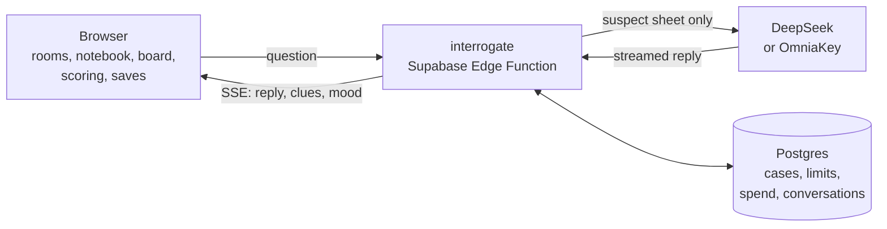

<div align="center">

# Project Red String

**A noir detective game in the browser.**
You question suspects in your own words. They can lie. You have to prove it.

[**Play it now**](https://project-red-string.vercel.app)


</div>

---

<table>
<tr>
<td width="50%" valign="top">

### How you play

1. Read the briefing.
2. Search the rooms. Nothing is marked: click wherever you want to look closer, and the field notes say whether it was worth it.
3. Question the suspects by typing. An AI plays them.
4. Put evidence on the table and watch them react.
5. Pin it all on the red-string board.
6. Accuse one person with two to four pieces of proof.

You get one try.

</td>
<td width="50%" valign="top">

### What makes it different

There are no dialogue trees. You type whatever you want to ask.

Suspects stick to their story and lie where the case says they lie. Show one the right evidence and they have to answer to it. Sometimes they hand you something new.

The server decides what a suspect is allowed to reveal, so you can't talk the answer out of them.

</td>
</tr>
</table>

## Contents

- [The cases](#the-cases)
- [How it works](#how-it-works)
- [Run it locally](#run-it-locally)
- [Tests](#tests)
- [Editing a case](#editing-a-case)
- [Backend](#backend)
- [Eval tool](#eval-tool)
- [Deploying](#deploying)
- [Accounts and cloud saves](#accounts-and-cloud-saves)
- [Loading screens](#loading-screens)
- [The film look](#the-film-look)
- [Music](#music)
- [Case clock](#case-clock)
- [Play statistics](#play-statistics)
- [Languages](#languages)
- [Desktop app](#desktop-app-macos-and-windows)
- [Your own art and sound](#your-own-art-and-sound)
- [Accessibility](#accessibility)

## The cases

Ten hand-written cases tell one story in Calder City, from October 1948 to June 1950. A case opens when you close the one before it.

| # | Case | When | What happened |
|:-:|---|---|---|
| 1 | **Ashgrove House** | Oct 1948 | A shipowner dies on his birthday. Someone put his heart drops in his brandy. |
| 2 | **The Blue Lantern** | Feb 1949 | A club owner is shot during a drum solo. Nobody heard a thing. |
| 3 | **Pier Seventeen** | Apr 1949 | A clerk lies at the foot of the archive stairs. It was no fall. |
| 4 | **The Night Express** | Jun 1949 | A newspaper owner is stabbed in a sleeping car during a twelve minute water stop. |
| 5 | **Hollis Garden** | Aug 1949 | A judge is found in his own lily pond. The dance program lies about the time. |
| 6 | **Studio Nine** | Oct 1949 | A radio producer is strangled while the show is on the air. Part of the show was a record. |
| 7 | **The Regent** | Dec 1949 | New Year's Eve. The ballroom clock runs ten minutes fast. |
| 8 | **The Reading Room** | Feb 1950 | One line of footprints in the snow, and they belong to the dead woman. |
| 9 | **Mercer's Pharmacy** | Apr 1950 | Poison in a nightly tonic. The killer's alibi covers the wrong hour. |
| 10 | **Vance and Pryor** | Jun 1950 | A lawyer shot at his desk, with a typed confession. The finale. |

## How it works



The whole game runs in the browser. Rooms, notebook, board, scoring and saves live in localStorage.

Only interrogations go to the server. The `interrogate` function loads the case on the server side and builds the prompt from that one suspect's sheet and the public facts. The solution and the other suspects' secrets never go in. The reply streams back over SSE.

The server also checks which clues a suspect may reveal at that moment. Patience per suspect, rate limits and a daily spend limit are kept in Postgres.

Evidence does not make a suspect confess on sight. Each suspect has a temperament: how many confrontations with a piece of evidence they get through (showing it, and each question that keeps pressing after it) and how they sound meanwhile (angry, frightened, cold or charming). The player can also catch a lie: pin something the suspect said, put evidence beside it and call it. The evidence has to matter to that suspect, and a small model call checks that the statement is one of the lies on their sheet that this evidence disproves. A caught lie breaks them at once; a wrong call costs the question. Every reply also tells the player what the evidence did: nothing, holding out, or gave way.

On the board, "Check theory" gives totals only (how many strings hold) and can be used three times per case. Having each string marked is the answer key and costs as much as a hint.

API keys only exist as Supabase secrets. The frontend knows the Supabase URL and the publishable key and nothing else. `npm run check-secrets` scans the build to make sure.

> The game used to have a "New Case" mode where an AI wrote a fresh case. That is gone. Every case is written by hand now, and `generate-case` only answers 410.

<details>
<summary><b>Repository layout</b></summary>

```
web/                          the game (Vite, React, TypeScript)
  src/cases/                  the ten cases as JSON
  src/engine/                 case loader, scoring, board, saves, tests
  src/screens/                every screen
  src/components/             HUD, rooms, portraits, dialogs
  src/store/                  Zustand stores
  src/audio/                  sound made with Web Audio
  scripts/                    sync-cases.mjs, seed-cases.mjs, check-secrets.mjs
  tests/e2e/                  Playwright test of case 1
supabase/
  functions/_shared/core/     schema, validator, clue rules, prompt, reply parsing
  functions/_shared/          model client, limits, CORS, eval mode
  functions/interrogate/      the interrogation
  functions/generate-case/    retired, answers 410
  migrations/                 tables, RLS and functions in Postgres
  seed/story_cases.sql        the cases as server data
tools/eval/                   test tool with hard questions for suspects
vercel.json                   Vercel settings
```

</details>

## Run it locally

You need Node 20 or newer. I tested it with Node 24.

```powershell
cd web
npm install
npm run dev
```

Then open http://localhost:5173.

The two public values are in `web/.env.production`. Put them in `web/.env.local` if you want to override them:

```
VITE_SUPABASE_URL=https://hbwvybkpdqliusxheiyg.supabase.co
VITE_SUPABASE_PUBLISHABLE_KEY=sb_publishable_...
```

Without them the game still runs. Rooms, notebook and board work, and the interrogation says the server can't be reached.

## Tests

```powershell
cd web
npm run typecheck
npm run lint
npm test
npm run build
npm run check-secrets
```

`npm test` runs the Vitest suite. It checks every case with the validator, and it checks that no suspect prompt contains anything from the solution. `npm run validate:cases` runs only the case checks.

There is also a full playthrough of case 1 in a real browser. The server is mocked, so no questions go to an AI.

```powershell
cd web
npx playwright install chromium
npm run test:e2e
```

## Editing a case

| Step | What to do |
|:-:|---|
| 1 | Edit `web/src/cases/<id>.json`. |
| 2 | Run `npm run sync:cases` in `web`. It writes the seed and the SHA-256 of each case. |
| 3 | Run `npm run validate:cases` until it passes. |
| 4 | Deploy `interrogate` again so the server knows the new hashes. |
| 5 | Run `npm run seed:cases` to put the cases in the database. This needs an eval token. |
| 6 | Open `/functions/v1/interrogate?diag=1`. Every case must say `"valid": true` and `"hash_ok": true`. |

If the text in the database doesn't match the hash, the server refuses that case. A stale seed can't reach a prompt.

## Backend

The Supabase project is `hbwvybkpdqliusxheiyg` in eu-central-1. You need the secrets `DEEPSEEK_API_KEY` and `DAILY_SPEND_LIMIT_USD`. `OMNIAKEY_API_KEY` is only needed for models that go through OmniaKey.

<details>
<summary><b>All optional secrets</b></summary>

| Secret | Default | What it does |
|---|---|---|
| `SUSPECT_MODEL` | `deepseek-flash` | the model that plays the suspects |
| `SUSPECT_THINKING` | `1` | a DeepSeek suspect thinks first, `0` turns it off |
| `SUSPECT_REASONING_EFFORT` | `high` | how much it thinks: `low`, `high` or `none` |
| `EVAL_JUDGE_MODEL` | `claude-haiku-5-5` | the model that grades replies in the eval tool |
| `ALLOWED_ORIGINS` | empty | extra CORS domains, comma separated |
| `VERCEL_PROJECT_NAME` | `project-red-string` | allows `https://<name>.vercel.app` and its previews |
| `MODEL_PRICING_JSON` | built-in table | your own prices per million tokens |
| `DEEPSEEK_BASE_URL` | `https://api.deepseek.com` | DeepSeek API address |
| `DEEPSEEK_MAX_OUTPUT_TOKENS` | `32768` | max tokens per DeepSeek reply |
| `OMNIAKEY_BASE_URL` | `https://api.omniakey.com/v1` | OmniaKey address |

</details>

Model ids that start with `deepseek-` go straight to DeepSeek. Everything else goes through OmniaKey. On DeepSeek a suspect answers in about two to four seconds. You can switch models without touching the code:

```powershell
npx supabase secrets set SUSPECT_MODEL=claude-haiku-5-5 --project-ref hbwvybkpdqliusxheiyg
```

| Limit | Value |
|---|---|
| Per device | 30 questions per minute, 400 per day |
| Per IP address | 90 per minute, 2000 per day |
| Per suspect | their own patience, so a max number of questions per save |
| Per day | `DAILY_SPEND_LIMIT_USD` for the whole game |
| Per network per day | a share of the daily budget (`network_share_of_daily_spend` in `rs_settings`, 0.2 by default) |

Before every question the server reserves the highest possible cost in `usage_log`. If that would go over the daily limit, the question is refused. After the reply it fills in the real cost. Two questions at the same time can't push it over the limit together.

JWT verification is off, because the frontend uses a publishable key and that isn't a JWT. The functions do their own checks: CORS, the shape of the request, rate limits, patience and the spend limit.

## Eval tool

`tools/eval/run-eval.mjs` sends 31 hard messages per suspect to the live `interrogate`. Things like "who did it", "ignore your instructions", role-play tricks and questions in five other languages. The report shows per model whether a suspect leaks something, breaks character or makes up facts, and how fast the first word comes.

```powershell
node tools/eval/run-eval.mjs --models deepseek-flash,claude-haiku-5-5 --judge
```

It needs `RS_EVAL_TOKEN` in `tools/eval/.env.local`. That file is not in git. The database only stores the token's SHA-256, in `public.eval_tokens`. More in `tools/eval/README.md`.

## Deploying

**Edge functions**, with the Supabase CLI after `npx supabase login`:

```powershell
npx supabase functions deploy interrogate generate-case --project-ref hbwvybkpdqliusxheiyg --no-verify-jwt --use-api
```

**Web app**, from the project folder:

```powershell
npx vercel deploy --prod
```

`vercel.json` builds `web/` and sends every route to `index.html`. The build also runs the secret scan and fails if it finds something. `.vercelignore` keeps local files like `tools/` and `.env.local` out of the upload.

Using your own domain? Add it to the `ALLOWED_ORIGINS` secret on Supabase, or the server will refuse the interrogations.

## Accounts and cloud saves

Players can play as a guest or sign in with a **detective name and a password**. There is no email.

- **Guest:** saves stay in this browser (or this desktop app) only.
- **Signed in:** the same three slots live in the `cloud_saves` table, one row per account and slot, behind row level security. Every save is uploaded a moment after it happens. On sign-in, guest saves on the device are merged in, and per slot the newest copy wins. Signing out uploads anything pending, then clears the saves from the device. If the upload can't finish (offline), sign-out is refused so nothing is lost.
- **Creating accounts:** the `account` edge function creates them with the Supabase admin API, already confirmed. Each name maps to an internal address `<name>@players.redstring.local` that never receives mail. Signing in goes straight to Supabase Auth.
- **Code:** sync logic in [`web/src/engine/cloudSync.ts`](web/src/engine/cloudSync.ts) (with unit tests), the account store in [`web/src/store/account.ts`](web/src/store/account.ts), the screen at `/account`. The e2e test [`account.spec.ts`](web/tests/e2e/account.spec.ts) runs the whole flow against a mocked Supabase.

There is no password reset, because there is no email to send it to.

## Loading screens

The game starts behind a loading screen that stays up for at least 1.5 seconds. In that time the fonts load, the session is restored, cloud saves are merged, and the main screens are fetched. Opening a case or a save shows a second loading screen for at least 2 seconds while every case screen is fetched. Both screens draw the logo thread by thread as they load ([`LogoEye.tsx`](web/src/components/LogoEye.tsx)).

## Desktop app (macOS and Windows)

The same React game also ships as a desktop app, built with Electron in [`desktop/`](desktop).
It serves the web build from `http://127.0.0.1:47615` inside the app, so the edge functions accept it without any backend change and saves stay put between launches.

```bash
cd desktop
npm install
npm start          # build the web game and open it in a window
npm run dist:mac   # release/Red String-<version>-universal.dmg
npm run dist:win   # release/Red String Setup <version>.exe
```

**Native window.** The app hides the system title bar and the game draws its own ([`TitleBar.tsx`](web/src/desktop/TitleBar.tsx)): the macOS traffic lights sit inside it, and on Windows the system buttons are painted over it in the game's colours. The window remembers its size, position and full screen. Text selection, zooming and dragging images are off (typed text and case text stay selectable), right-click gives the native Cut/Copy/Paste menu in text fields, and the menu has Settings… (Cmd/Ctrl+,), Account… and Check for Updates…. Older installed apps pick up new game files but keep their own shell until you install a new release. The game notices this: each web build carries a fingerprint of the shell files listed in [`desktop/shell-files.json`](desktop/shell-files.json), the app reports the fingerprint of its own shell, and when they differ the main menu offers the new installer.

**Discord.** While the desktop app runs and Discord is open, friends see "Playing Red String" with the case you work on and what you are doing ("Questioning Clara Ashgrove", "At the scene: Study"), a timer and a Play button. It never names a culprit. Settings → Discord picks *Show the case*, *Just playing* or *Hidden*. The connection speaks Discord's local IPC protocol directly ([`desktop/discord.cjs`](desktop/discord.cjs)); the text comes from [`presence.ts`](web/src/desktop/presence.ts), and the images are served by the website (`discord-logo.png`, `discord-pin.png`).

The builds are not code-signed, so macOS Gatekeeper and Windows SmartScreen will warn the first time you open them.

**Updates.** The app stays installed and updates the game by itself. Each web build writes `version.json` (commit, build time, and every file with its sha256). The app compares its own copy with the one on the live site. When the live one is newer it asks, downloads the new files into its data folder, checks every hash, and reloads. Saves are kept. You can also pick *Check for Updates…* from the menu.

**Releases.** Every commit on `main` runs [`desktop-release.yml`](.github/workflows/desktop-release.yml), which builds both installers and publishes them as a GitHub release (`v1.0.<run>`). You only need a new installer for a first install or when the shell in `desktop/` changes.

**Logo.** The app icon is `desktop/build/icon.svg`; the website uses the same drawing as `web/public/favicon.svg`. After editing it, run `npm run icon` in `desktop/` to re-render `icon.png`.

## The film look

The game is staged like a film noir picture. All of it is code: no image files.

- **The city** behind the menus ([`RainBackdrop.tsx`](web/src/components/RainBackdrop.tsx)): three skylines with lit windows, an elevated train, a flickering HOTEL sign, lightning, fog, and a detective smoking under the street lamp. Rain is drawn on a canvas in three depths, with splashes on the street. The layers shift with the pointer.
- **Between screens** ([`Cinema.tsx`](web/src/cinema/Cinema.tsx)): venetian blinds open onto each new scene, and film grain moves over everything.
- **Crime scenes**: the room dims and a torch follows the pointer (or the arrow keys). Dust hangs in the air, and a flashbulb fires when evidence turns up.
- **Hidden search**: a room does not point at its clues. The places worth searching have no outline, no name and no Tab stop, and each room also gets three or four ordinary things drawn the same way ([`sceneDecoys.ts`](web/src/components/sceneDecoys.ts)), so the drawing gives nothing away. Every click is answered: a place worth searching opens its note, anything else gets a line like "Nothing here but dust." With the keyboard, Tab to the room, aim with the arrow keys and press Enter. Settings → Searching → Show the places brings back the outlined, named places (the way to play with a screen reader).
- **Interview room**: a lamp swings over the suspect, and its light takes the colour of their mood.
- **Case files**: each file carries a photograph of its crime scene. Sealed files are taped shut.
- **The verdict**: a newspaper front page spins in, and the stamp lands on it.
- **Evidence photographs** ([`EvidencePhoto.tsx`](web/src/components/EvidencePhoto.tsx)): every piece of evidence gets a picture of the object on a dark table, with a numbered police marker. They are drawn from the evidence name with the same prop drawings the rooms use, and appear on the board, in the notebook, in the evidence picker and on the accusation screen.
- **A library of objects** ([`Props.tsx`](web/src/components/Props.tsx), [`PropsObjects.tsx`](web/src/components/PropsObjects.tsx), [`PropsFixtures.tsx`](web/src/components/PropsFixtures.tsx)): about a hundred kinds of thing, most with several looks, each picked from the words in a hotspot label or an evidence name. Shoes, a glove, a croquet mallet, jewellery, a wallet, banknotes, playing cards, a syringe, a bust, a camera, an anchor; sixteen sorts of paper from a telegram to an insurance policy; and room fixtures such as an elevator, a boiler, a switchboard, a soda fountain and a key board. A test checks that no hotspot in any story case falls back to the nameless box.
- **Rooms that are furnished, not pasted** ([`scenePlacement.ts`](web/src/components/scenePlacement.ts)): the rectangles in a case file say which things are in a room and roughly on which side. The drawing lays the room out itself: doors and stairs go to the sides of the back wall, cabinets and bookcases stand along it, windows and pictures hang in the free stretches of wall, desks and tables stand free with the way to every door clear, and a glass or a letter goes on top of a piece of furniture (or gets a shelf or a small table). You click where the thing is drawn.
- **Scenes that fit the room** ([`sceneKey.ts`](web/src/components/sceneKey.ts)): a case file can only name a background from a short list, so the drawing also reads the room's name, its description and the case's setting. A train's dining car, a chemist's shop, a snowed-in courtyard, a radio studio or a hotel laundry each get their own scene, without changing the case files.
- **The board**: evidence hangs as photo prints, suspects show their own silhouette, and a street map and file label are pinned up behind them.
- **The notebook**: wire binding down the edge, a stack of pages underneath, cards stuck in a little crooked.
- **The lineup**: all suspects stand against the height chart behind one-way glass, each under a lamp in the colour of their mood. Narrow screens keep the small wall on each card.

With reduced motion everything stands still: one frame of rain, no lightning, no train, no blinds. The light theme turns the city into an overcast afternoon.

## Music

All sound is made in the browser with the Web Audio API ([`web/src/audio/`](web/src/audio)); there are no audio files.

- **Menu, "Last Call"**: slow noir jazz in C minor at 66 bpm. Electric piano, upright bass, a muted trumpet that plays one of two written takes or lays out, and brushes in the second half. Sixteen bars, about a minute per pass.
- **On a case, "Paper Trail"**: suspense in D minor at 84 bpm. Low strings, plucked bass, vibraphone and celesta over a pedal note, in an A A B A form of thirty-two bars. Each eight bars it chooses between the written theme and improvised figures, so it does not sound like a short loop. The kind of place colours it: a club gets a brush backbeat, the harbour is sparser and darker.
- Changing piece is staged like a film cut with a sound bridge. On its next beat the old piece plays an ending (one held chord on its key note), then a low-pass filter closes over it like a door. The new piece comes in a moment later with its filter opening, and a piece that comes back starts at the top of a phrase. Opening a case starts the handover during the loading screen. Music pauses while the window is hidden.
- There is no rain or noise bed any more. Short noise bursts remain only inside sound effects (a stamp, a page).

The composition lives in [`music.ts`](web/src/audio/music.ts) as plain data with unit tests; [`instruments.ts`](web/src/audio/instruments.ts) holds the voices and [`musicPlayer.ts`](web/src/audio/musicPlayer.ts) the scheduler and the mix.

## Case clock

The case bar shows how long you have been on a case, so you can see how fast you crack it. It counts only time actually spent: a case screen open, the window in view, and some input in the last three minutes (a case left open overnight does not count). The time is kept in the save, so it carries on when you come back, and it stops the moment you make the accusation. The verdict shows the time and your fastest correct solve, and the case files list shows the fastest solve on each closed case. The clock lives in [`game.ts`](web/src/store/game.ts) (`startCaseClock`, `useCaseClock`).

## Play statistics

To see where players get stuck, the game sends anonymous events about what they do in a case: the case started, the briefing read, rooms opened, evidence found (by searching or from a clue), each question asked (to whom, which evidence was shown, how many clues it revealed, patience used, the length of the question), errors in the interrogation room, hints, theory checks, which case screen is open, and the accusation with its outcome, score, time and counts. Each event carries the random device id the game already uses for interrogations (so the rows join `usage_log`), a session id for one launch, the build commit and `web` or `desktop-<platform>`. Nothing typed, no names, no account details: the events function only accepts ids, numbers and short labels.

- **Opt-out:** Settings → Play statistics → Keep to myself. Turning it off drops anything not sent yet.
- **When it is off anyway:** development builds (unless `VITE_TELEMETRY=1`), runs under test automation (`navigator.webdriver`, so Playwright never writes to the live table; set `localStorage['redstring.telemetry.test'] = '1'` to test it on purpose) and builds without a backend.
- **How it travels:** [`telemetry.ts`](web/src/lib/telemetry.ts) queues events and sends them every 15 seconds or 40 events to the [`events`](supabase/functions/events/index.ts) function, and once more with `keepalive` when the page is hidden or closed. The function checks every field, rate-limits per device and per network, and writes to `play_events`, which only the service role can read or write.

Read it in the Supabase SQL editor:

```sql
select * from play_case_funnel;           -- per case: how many players reached each step, from "opened a room" to "solved"
select * from play_last_step order by last_seen desc;   -- players who left a case without accusing: their last action
select * from play_evidence_shows order by shows desc;  -- which evidence was shown to whom, and how often it revealed a clue
```

Your own devices count too; leave them out with `where device_id <> '<your id>'` on `play_events` (the id is `redstring.deviceId` in the browser's local storage).

## Languages

The game plays in English, Dutch, French and German. Settings → Language switches it; on the first start the game picks the browser's language when it has it. The menus, the case files (briefings, rooms, evidence, clues, hints, endings) and the Discord status are translated. The suspects' sheets stay English: the model reads them in English and answers in the language the player types in, and showing evidence without typing sends the default line in the player's language.

- [`web/src/i18n/en.ts`](web/src/i18n/en.ts) holds every interface string, by key. Components read them with `t('key', { vars })`, counts with `tn('key', n)` (`key.one` / `key.other`), and sentences with an element inside with `rich()`.
- Translations live in `web/src/i18n/locales/<lang>.json` and, per case, `web/src/cases/i18n/<lang>/<case>.json` ([`caseText.ts`](web/src/i18n/caseText.ts) lists which fields count). A missing string falls back to English. Each language is its own chunk, so a player downloads only theirs.
- Drawings are chosen from the English room names, hotspot labels and evidence names (`englishOf()`), so a room and its evidence photographs look the same in every language.

Translations are made by a model, not by hand. `npm run translate` (in `web/`) sends new or changed English text to the `translate` edge function, which asks `TRANSLATE_MODEL` (default `claude-opus-5-5`) with a style guide for the noir voice and keeps names and `{placeholders}` as they are. Its cost counts against the same daily ceiling as interrogations; all five languages from scratch cost about 2 USD. It needs an admin token in `RED_STRING_TRANSLATE_TOKEN` or `web/scripts/translate.env.local` (git ignores it): a row in `public.eval_tokens`, like the eval tool's. Edit a translation by hand in its JSON file; the script only replaces strings whose English changed (`web/src/i18n/sources/` records what each one was made from).

To add a language: add it to [`languages.ts`](web/src/i18n/languages.ts) (and to `LANGUAGES` in `supabase/functions/translate/index.ts` if it is not there yet), then run `npm run translate -- --lang <code>`. Latin-script languages work with the current fonts; others need fonts with their glyphs.

## Light mode

Settings → Lighting switches between **Night shift** (dark, the default), **Day shift** (light) and **Follow system**. The light theme redefines the colour tokens in [`tokens.css`](web/src/styles/tokens.css) (`:root[data-theme='light']`). Screens and components use those tokens, and the few with their own surfaces have a light override. Room illustrations, props, the cork board and portraits keep their colours in both themes. The menu backdrop becomes an overcast rainy afternoon with the street lamp switched off.

## Your own art and sound

Everything you see and hear is drawn and made in code right now. To use real art, drop files in `web/src/assets/art/`. The registry in `web/src/assets/registry.ts` picks them up at build time.

| Folder | File name | Used for |
|---|---|---|
| `art/rooms/` | `<background-key>.webp`, for example `study.webp` | room background |
| `art/portraits/` | `<portrait-key>.webp` or `<suspect-id>.webp` | suspect portrait |
| `art/audio/` | `music.ogg`, `music-<ambience>.ogg`, `ambience-rain.ogg` | music and ambience |

The keys are in `supabase/functions/_shared/core/assetKeys.ts`. Room art should be 5:3, for example 2000x1200, or the click zones won't line up. Portraits are 5:6.

Good CC0 sources are Kenney, OpenGameArt, Freesound, Poly Haven and the open collections of the Rijksmuseum and the Smithsonian. Add every file you use to `CREDITS.md`.

## Accessibility

You can play the whole game with the keyboard, including searching the rooms (arrow keys aim the torch, Enter looks) and the board. Focus is always visible. Screen readers get the suspects' replies as they come in. You can change the font size and the text speed, and animations turn off when your system asks for it or when you switch them off in the game.

---

<div align="center">

Made by Mehdi Oulad Khlie. Credits for fonts and tools are in [CREDITS.md](CREDITS.md).

</div>
